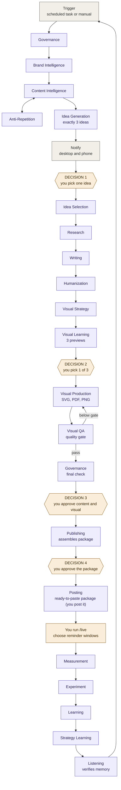
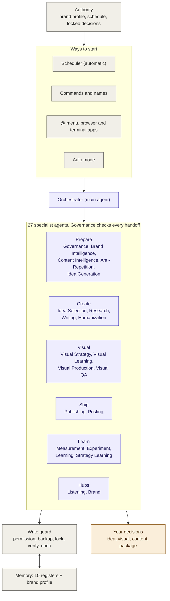
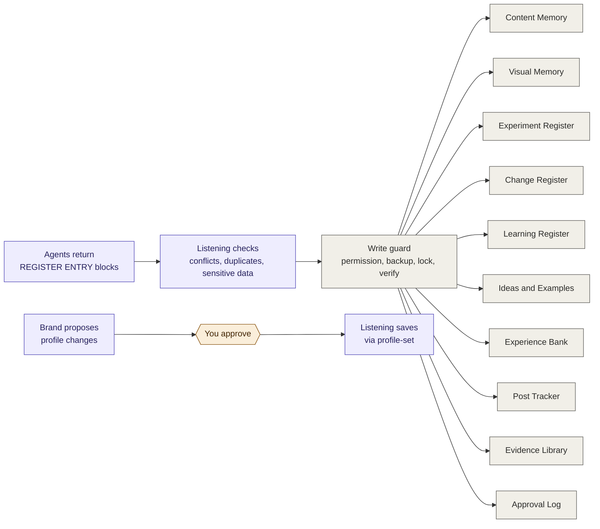
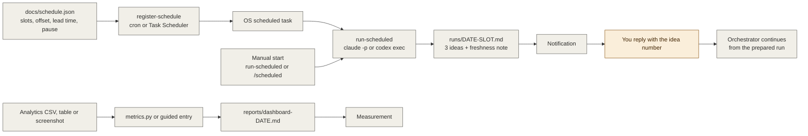
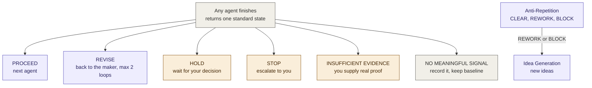

# 360 flow chart: agents and workflows

These diagrams render automatically on GitHub. Purple = agent, amber = your decision, grey = system step.

## 1. Weekly cycle (28 agents, four decisions)

## 2. System architecture (360 view)

## 3. Memory: who writes what

## 4. Automation: scheduler, manual start, metrics

## 5. What happens on each agent state

## 6. Command to agent map

| Command | Agent(s) | Output |
|---------|----------|--------|
| `/next` | Governance, Brand Intelligence, Content Intelligence, Anti-Repetition, Idea Generation | Exactly 3 ideas |
| `/lock` | Idea Selection | Selected Idea Brief |
| `/research` | Research | Evidence Pack |
| `/write` (`/draft`) | Writing | Post Draft |
| `/humanize` | Humanization | Humanized Draft |
| `/visual` | Visual Strategy, Visual Learning, then Visual Production and Visual QA after your pick | 3 previews, then the rendered visual |
| `/visualqa` | Visual QA | QA result and score |
| `/audit` | Governance | Governance Status |
| `/package` | Publishing | Publishing Package |
| `/publish` | Posting | Posting Instruction and Result |
| `/review` | Measurement, Experiment | Measurement Record, Experiment Status |
| `/learn` | Learning, Listening, write guard | Learning Record, memory updated |
| `/weekly`, `/monthly` | Strategy Learning (and Brand for the monthly brief) | Strategy Brief |
| `/idea`, `/example` | Listening | Filed in Ideas and Examples |
| `/live` | Posting data into the Post Tracker | Final text, link, reminder windows |
| `/metrics` | Measurement | Guided entry |
| `/comments` | Brand | Risk flags and reply drafts |
| `/undo`, `/export`, `/forget` | Write guard | Restore, zip, delete |
| `/auto`, `/scheduled`, `/orchestrator` | Orchestrator | Pipeline, slot preparation, direct chat |
| `/governance` ... `/brand` | The agent of that name | Its own output |
